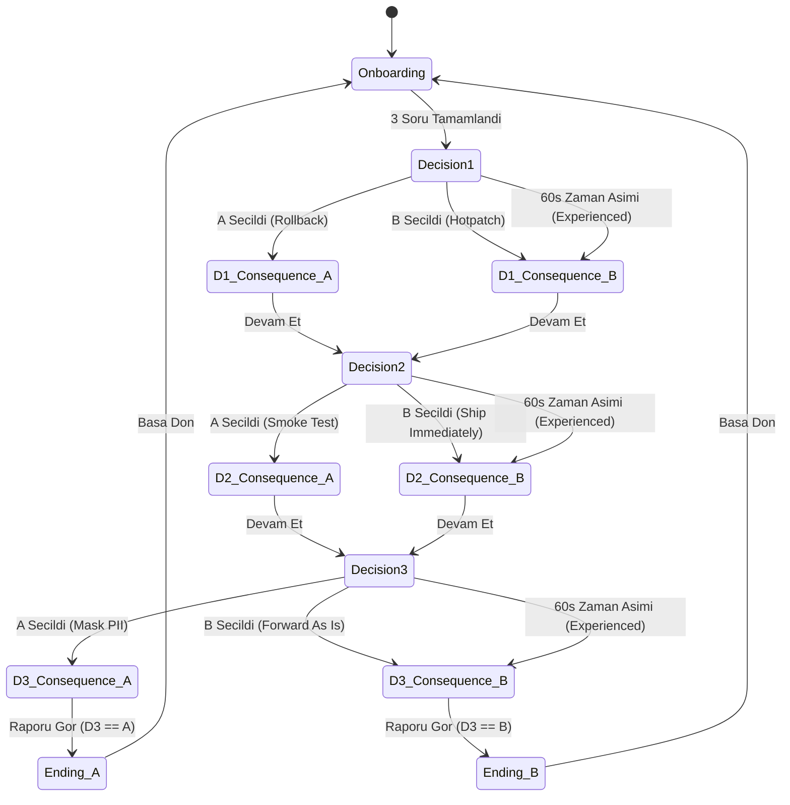

# YZM301 - SE Primer: Sistem Mühendisi İnteraktif Hikaye Simülasyonu
## Sistem Analiz ve Tasarım Spesifikasyonu (`spec.md`)

---

## 1. Problem Statement & Background

Sağlık bilişimi ve kritik altyapı sistemlerinde yazılım mühendisliği pratikleri yalnızca kod yazmaktan ibaret değildir; mimari kararlar, test disiplini ve KVKK (Kişisel Verilerin Korunması Kanunu No: 6698) gibi yasal mevzuat sınırları hayati öneme sahiptir. Acil kriz anlarında (on-call / nöbet) mühendisler, baskı altında trade-off (ödünleşim) analizi yapmak zorundadır.

**SE Primer**, Neal Stephenson'ın *The Diamond Age* adlı eserindeki etkileşimli Primer konseptinden esinlenen, kişiselleştirilmiş, mobil-öncelikli web tabanlı bir karar simülasyonudur. Oyuncu, sabah 08:00'de çöken bir hastane randevu sisteminin nöbetçi mühendisi olarak 3 kritik karar verir. Her seçimin teknik gerekçesi ve mimari sonucu ("ne oldu" ve "neden oldu") oyuncuya aktarılır. Oyuncuya eşlik eden yapay zeka mentoru (Sokratik AI Tutor), hiçbir zaman doğrudan cevabı vermeden, yönlendirici sorularla oyuncunun teknik muhakemesini geliştirir.

---

## 2. Kapsam Dışı Unsurlar (Out of Scope)

Projenin yalın kalması, tek oturuşta pedagojik çıktının ölçülebilmesi ve Google AI Studio üzerinde sorunsuz çalışabilmesi için aşağıdaki öğeler **kapsam dışı** bırakılmıştır:
1. **Kullanıcı Kayıt / Oturum Açma (Auth & Accounts):** Oyuncu oturumları hafızada ve oturum bazlı (session state) tutulur, harici veritabanı / JWT / OAuth kullanılmaz.
2. **Çoklu Bölüm / İkinci Senaryo (Multiple Chapters):** Sadece sağlık randevu sistemi krizi odaklı tek bir 3-adımlı senaryo mevcuttur.
3. **Gerçek Hasta Verisi (Real Patient PII):** Hiçbir şekilde gerçek hasta verisi kullanılmaz, tüm isim ve T.C. kimlik numaraları sentetiktir.
4. **Native Mobil Uygulama (iOS/Android):** Cordova, React Native veya Flutter yerine modern, mobil tarayıcı uyumlu (responsive/mobile-first PWA-ready) web arayüzü sunulur.
5. **Sesli Anlatım / Çoklu Dil / Liderlik Tablosu:** Gereksiz karmaşıklığı önlemek adına arayüz tamamen Türkçe, ses/puanlama rekabeti olmadan tasarlanmıştır.

---

## 3. Kişiselleştirme ve Durum Kuralları (Personalization Rules)

Oyuna başlarken kullanıcı 3 soru yanıtlar:
- **Seviye (`level`):** `beginner` (Başlangıç) veya `experienced` (Deneyimli)
- **Rol (`role`):** `backend` (Backend Geliştirici), `devops` (DevOps / SRE), `frontend` (Frontend / Fullstack)
- **Hedef (`goal`):** `uptime` (Sistemi Hızlıca Ayakta Tutmak), `compliance` (Veri Güvenliği ve Mevzuat), `learning` (Hatalardan Öğrenmek)

### Dinamik Mekanikler:
1. **Başlangıç Seviyesi (`beginner`):** Her karar kartında Sokratik mentorun otomatik ipucu paneli açık gelir ve karar seçeneklerinin olası teknik risklerini önden ima eden rehber notlar gösterilir. Geri sayım baskısı yoktur.
2. **Deneyimli Seviye (`experienced`):** Karar anında 60 saniyelik geri sayım sayacı çalışır.
   - *Teknik Karar / Zaman Aşımı İlkesi:* 60 saniye dolduğunda kriz ortamında karar vermemenin kendisi bir karardır (hareketsizlik / analiz felci). Sistem panik haliyle varsayılan aceleci seçeneği (Seçenek B: Canlıda Yama / Test Etmeden Yayına Al / Logları Olduğu Gibi Paylaş) otomatik uygular.
   - *Sayaç Sürekliliği:* Geri sayım sayacı, Sokratik mentor çekmecesi açıldığında veya mentora soru sorulurken de duraklamaz; arka planda geri saymaya devam eder (gerçekçi kriz baskısı).
   - *Zaman Aşımı Bildirimi:* Ekranda "Baskı altında karar vermemek de fiili bir karardır: Zaman aşımı nedeniyle sistem acil durum varsayılanını (B) devreye soktu." teknik gerekçesi gösterilir.
3. **Rol ve Hedef Yansımaları:** Sahne anlatım metninde, log detaylarında ve sonuç analizinde role özgü terminoloji kullanılır:
   - `devops`: Pod restart döngüleri, Kubernetes ingress, canary deployment ve deployment rollback terimleri vurgulanır.
   - `backend`: DB connection pool tükenmesi, thread starvation, SQL migration ve ORM entity locking terimleri öne çıkar.
   - `frontend`: Client-side retry storm, Gateway Timeout (HTTP 504), queue backlog ve kullanıcı deneyimi etkileri vurgulanır.
   - `goal`: Seçilen hedefe göre (uptime, compliance, learning) kriz anındaki KPI ve başarı ölçütleri vurgulanır.

---

## 4. Karar Ağacı, Teknik Borç ve Bitiş Haritası (Decision Flow & Technical Debt)

### Senaryo Başlangıcı
> **"08:00, randevu sistemi çöktü. Nöbetçi sensin."**  
> Dün gece sisteme yeni sürüm (v2.4.0) yüklendi. Kapıda 300 hasta randevu sırası bekliyor. Hata: HTTP 500 & Connection Pool Exhaustion.

### Kararlar:
* **Karar 1 (Mimari / Architecture):**
  * **[A] Eski sürüme geri dön (Rollback):** v2.3.9 sürümüne anında dönüş tetiklenir.
    * *Ne oldu:* Trafik eski kararlı sürüme yönlendirildi, servis ayağa kalktı.
    * *Neden oldu:* Gece çalıştırılan DB migration geriye uyumlu tasarlandığı için eski kod tabanı veritabanını okuyabildi (schema compatibility).
    * *Teknik Borç Etkisi:* Eski sürüme dönüldü ancak dün geceki yeni özellikler devre dışı kaldı; şema göçünün geriye uyumluluk doğrulaması teknik borç olarak backlog'a eklendi.
  * **[B] Canlı sistemde yama yap (Hot-patch in Prod):** Canlı sunucu/container üzerinde acil yama uygulanır.
    * *Ne oldu:* Canlı ortamdaki konfigürasyon ve havuz parametreleri anlık script ile değiştirildi.
    * *Neden oldu:* Container içine girilerek thread pool limiti ve max connections elle yükseltildi, pod restart edilmedi.
    * *Teknik Borç Etkisi:* Ortam kayması (configuration drift) oluştu; canlıdaki değişiklik Git deposunda ve CI/CD pipeline'ında yer almadığı için bir sonraki dağıtımda ezilme riski doğdu.

* **Karar 2 (Test & Doğrulama / Testing):**
  * **[A] Önce hızlı bir smoke test çalıştır (Run quick smoke test):** 3 dakikalık kritik akış testi (randevu alma + DB yazma).
    * *Ne oldu:* Sentetik bir test hastasıyla randevu alma ve SMS gönderim akışı doğrulandı.
    * *Neden oldu:* Kritik kullanıcı senaryoları canlıya açılmadan önce sandbox üzerinde simüle edilerek regressions engellendi.
    * *Teknik Borç Etkisi:* Test süresince 300 hasta 3 dakika daha bekledi; ancak regresyon ve veri kirlenmesi riski sıfırlandı.
  * **[B] Test etmeden doğrudan yayına al (Ship immediately):** Doğrudan trafiği aç.
    * *Ne oldu:* Hiçbir doğrulama yapılmadan tüm gelen hasta trafiği doğrudan sisteme salındı.
    * *Neden oldu:* Hasta kuyruğunun baskısıyla bekleme süresini sıfırlamak için kalite kontrol kapısı (quality gate) bypass edildi.
    * *Teknik Borç Etkisi:* Edge-case'ler doğrulanmadığı için gizli hatalar, sessiz veri bozulmaları ve tutarsız işlem riskleri canlıda birikti.

* **Karar 3 (KVKK & Veri Güvenliği / Compliance):**
  * **[A] Loglardaki hasta verilerini maskele (Mask PII):** T.C. kimlik no ve hasta isimlerini regex/kriptografik tuzlama ile anonimleştirerek hata takip platformuna aktar.
    * *Ne oldu:* Hata analiz loglarındaki hassas hasta kimlik ve tanı verileri `***` ile maskelendi.
    * *Neden oldu:* KVKK Madde 6 ve Madde 12 gereği sağlık verileri özel nitelikli kişisel veri sayılır; üçüncü şahıslara ve log servislerine açık metin iletilemez.
  * **[B] Logları ekibe olduğu gibi ilet (Forward logs as-is):** Hızlı kök neden analizi için tüm stacktrace ve ham payload'ları Slack/WhatsApp kanalına yapıştır.
    * *Ne oldu:* Ham payload'lar, hasta isimleri ve T.C. kimlik numaraları harici mesajlaşma kanalına açık metin olarak düştü.
    * *Neden oldu:* Acil çözüm üretme telaşıyla veri minimizasyonu ve kurumsal güvenlik politikası çiğnendi; KVKK veri ihlali oluştu.

---

### D1 & D2 Teknik Borç Özeti ve 8 Yol Kombinasyonu

Bitiş ekranı iki ana eksene sahiptir:
1. **Nihai Yasal & Güvenlik Statüsü (Ending A vs Ending B):** Karar 3 (KVKK) belirleyicidir.
   - **Ending A:** KVKK kurallarına uyuldu, hasta verileri güvende tutuldu.
   - **Ending B:** KVKK ihlali gerçekleşti; hasta verileri yetkisiz kanallara sızdı (ve D1/D2 kaynaklı veri bozulmaları varsa ekstra teknik risk olarak eklenir).
2. **Teknik Borç & Operasyonel Miras Özeti:** D1 ve D2 seçimlerinden türetilen teknik karne bitiş ekranında açıkça listelenir:
   - D1=A: "Rollback nedeniyle özellik kaybı ve şema senkronizasyonu teknik borcu"
   - D1=B: "Hot-patch nedeniyle ortam kayması (configuration drift) ve CI/CD dışı kod borcu"
   - D2=A: "Smoke test ile doğrulanmış kararlı sürüm; sıfır regresyon borcu"
   - D2=B: "Testsiz canlıya alma kaynaklı gizli veri anomalileri ve regresyon riski"

| Yol Kodu | D1: Mimari | D2: Test | D3: KVKK | Nihai Bitiş | Bitiş Raporu ve Teknik Borç Detayı |
|---|---|---|---|---|---|
| **AAA** | Rollback (A) | Smoke Test (A) | Mask (A) | **Ending A (Kusursuz Kurtarma)** | 08:25 Sistem ayakta, veriler güvende. Şema geriye uyumluydu, smoke test doğruladı, KVKK tam uyumlu. Teknik borç: Minimum (yalnızca ertelenen v2.4.0 özellikleri). |
| **AAB** | Rollback (A) | Smoke Test (A) | As-Is (B) | **Ending B (KVKK İhlali)** | Sistem stabil ayağa kalktı ancak ham log paylaşımı nedeniyle KVKK 6698 ihlal bildirimi yapıldı. Teknik borç: Hukuki denetim ve log arındırma zorunluluğu. |
| **ABA** | Rollback (A) | Ship (B) | Mask (A) | **Ending A (Kısmi Başarı / Regresyon Riski)** | Sistem açıldı ve KVKK verileri korundu; fakat test yapılmadığı için bazı randevu istekleri mükerrer basıldı. Teknik borç: DB temizleme ve test otomasyon borcu. |
| **ABB** | Rollback (A) | Ship (B) | As-Is (B) | **Ending B (KVKK İhlali + Veri Tutarsızlığı)** | Sistemde KVKK ihlali gerçekleşti. Ek olarak test atlandığı için mükerrer hasta kayıtları ve loglarda açık PII sızıntısı çifte kriz yarattı. |
| **BAA** | Hot-patch (B)| Smoke Test (A) | Mask (A) | **Ending A (Pragmatik Kurtarma)** | Canlı yama smoke testten geçti ve KVKK korundu; sistem ayakta. Teknik borç: Canlıdaki yamanın Git'e aktarılması (configuration drift temizliği). |
| **BAB** | Hot-patch (B)| Smoke Test (A) | As-Is (B) | **Ending B (KVKK İhlali)** | Canlı yama çalıştı fakat paylaşılan ham hasta bilgileri nedeniyle başhekimlik ve KVKK kurulu soruşturma açtı. Teknik borç: Yasal yaptırım ve sızıntı analizi. |
| **BBA** | Hot-patch (B)| Ship (B) | Mask (A) | **Ending A (Yüksek Riskli Kurtarma)** | Sistem erken açıldı ve KVKK verileri korundu; fakat testsiz canlı yama sebebiyle prod ortamında gizli bug'lar kaldı. Teknik borç: Ciddi ortam kayması ve belirsiz edge-case'ler. |
| **BBB** | Hot-patch (B)| Ship (B) | As-Is (B) | **Ending B (Tam Yıkım)** | Hem kritik KVKK ihlali hem de kontrolsüz canlı yama ve test atlama yüzünden veri bozulmaları oluştu. Çifte idari ve teknik kriz. |

---

## 5. Düz Durum Diyagramı (Flat Mermaid State Machine)



---

## 6. Sokratik AI Tutor Tasarımı

1. **Pedagojik İlke:** Asla "A şıkkını seç", "Geri almalısın" veya nihai doğru seçeneği doğrudan söylemez. Sorulan soru ne olursa olsun, analiz ettirici bir karşı soru ve teknik bir ipucu sunar.
2. **Karakter & Dil:** Türkçe, nazik, analitik, kıdemli sistem mimarı üslubu. Maksimum 2-3 cümle.
3. **Sistem Prompt Dosyası:** `src/tutor/systemPrompt.ts` içinde izole tutulur.
4. **Doğrulama Ayrımı:**
   - **Cypress E2E (UI Entegrasyonu):** Cypress testleri deterministik mock (`cy.intercept`) kullanarak API isteğinin doğru parametrelerle ve sistem promptuyla atıldığını, gelen cevabın arayüzde doğru render edildiğini doğrular.
   - **Eval Test Paketi (`eval/`):** Modelin gerçekte doğrudan cevap sızdırıp sızdırmadığı (`leaked_answer`) 20 gerçekçi öğrenci sorusu içeren `run_eval.ts` ve etiketleme süreci ile bağımsız ölçülür.

---

## 6.1 Makine Öğrenmesi Modeli ve Uyarlamalı Müdahale (ML Model & Adaptive Intervention)

### 6.1.1 Modelin Amacı ve Çalışma Kapsamı (Model Purpose & Scope)
Oyuncunun karar adımlarında kriz baskısı altında riskli bir tercih yapma olasılığını ($P(\text{riskli})$) tahmin etmek.
- **Kapsam:** Model **1. Karar (Mimari) aşamasında ÇALIŞTIRILMAZ** (henüz geçmiş oturum geçmişi ve karar metriği bulunmamaktadır; bu sayede AC-1 ve AC-2 kuralları ilk kararda her zaman %100 geçerliliğini korur). Model yalnızca **2. Karar (Test)** ve **3. Karar (KVKK)** aşamalarında devreye girer.
- **Uyarlamalı Davranış:** Karar 2 veya 3 öncesinde modelin hesapladığı riskli seçim olasılığı belirlenen eşik değerin üzerindeyse ($P(\text{riskli}) \ge 0.50$), oyun arayüzü proaktif olarak müdahale eder:
  - 60 saniyelik kriz geri sayım sayacı kaldırılır (oyuncunun paniklemeden düşünmesi sağlanır).
  - Sokratik mentor ipucu paneli (`[data-testid="hint-panel"]`) otomatik olarak açık görüntülenir.
- **Veri toplama istisnası:** `?collect=1` modunda model müdahalesi tamamen kapalıdır. Timer ve ipucu davranışı doğal/standart kurallarla çalışır; otomatik ipucu açılmaz.
- **Zarif Çöküş (Graceful Fallback):** Model yüklenemezse veya ONNX çıkarımı başarısız olursa, oyun kuralları varsayılan klasik davranışa döner; sistem asla çökmez.

### 6.1.2 Model Girdileri / Nitelikler ve Birimleri (Features with Units)
Model karardan hemen önceki durumu temsil eden 5 sayısal nitelik alır (tüm nitelikler karar anından önce bilinmektedir):

1. **`seviye`** (Kategorik / Gösterge): Oyuncunun başlangıçta seçtiği deneyim seviyesi.
   - Değerler: `0` = Başlangıç (Beginner), `1` = Deneyimli (Experienced).
   - Birim: Birimsiz (0/1 ikili gösterge).
2. **`sahne_no`** (Tamsayı): Mevcut karar adımı sırası.
   - Değerler: `1`, `2`, `3` (Karar 1: Mimari, Karar 2: Test, Karar 3: KVKK).
   - Birim: Aşama indeksi.
3. **`onceki_ort_karar_suresi_sn`** (Ondalıklı Sayı): Oyuncunun aynı oturumda önceki kararlarda harcadığı ortalama karar süresi.
   - Sahne 1 için önceki karar olmadığından `0.0` değerini alır.
   - Birim: Saniye (`sn`).
4. **`onceki_ipucu_sayisi`** (Tamsayı): Oyuncunun aynı oturumda önceki kararlarda **yalnızca kendi isteğiyle açtığı veya sorduğu** ipucu sayısı (Model tarafından otomatik açılan proaktif ipuçları kesinlikle bu sayıya dahil edilmez / sayılmaz).
   - Sahne 1 için `0` değerini alır.
   - Birim: Adet.
5. **`onceki_riskli_secim_sayisi`** (Tamsayı): Oyuncunun aynı oturumda önceki kararlarda yaptığı riskli (B seçeneği) seçimlerin toplam sayısı.
   - Sahne 1 için `0` değerini alır.
   - Birim: Adet.

### 6.1.3 Hedef Değişken (Target)
- **`riskli_secim`** (İkili / Binary):
  - `0` = Oyuncu güvenli/savunmacı seçeneği (Seçenek A) tercih etti.
  - `1` = Oyuncu riskli seçeneği (Seçenek B: Canlıda yama, testsiz yayına alma, logları doğrudan iletme) tercih etti.
  - **Önemli Kural:** Yalnızca oyuncunun kendi iradesiyle yaptığı seçimler hedef olarak etiketlenir. Süre dolduğu için sistemin otomatik seçtiği zaman aşımı satırları (`zaman_asimi == 1`) model eğitiminde ve hedef hesaplamasında **hariç tutulur** (istemsiz varsayılan olduğu için).

### 6.1.4 Değerlendirme Metriği ve Başarı Eşiği (Eval Metric & Thresholds)
- **Metrik:** **ROC-AUC** (Receiver Operating Characteristic - Area Under Curve).
- **Sınıf Dağılımı ve Taban Çizgisi:** Gerçek sınıf dengesi (class balance), veri toplama süreci tamamlandıktan sonra toplanan gerçek veriler üzerinden raporlanacaktır. Sıfır bilgiye dayalı rastgele tahmin taban çizgisi **ROC-AUC = 0.50**'dir.
- **Kabul Eşiği (Acceptance Threshold):**
  - **Kabul Kriteri:** Modelin gerçek veriler üzerindeki doğrulama çıktısında elde ettiği **ROC-AUC $\ge$ 0.65** olmalıdır.
  - **Gerekçe:** Yaklaşık 45 gerçek satırlık sınırlı veri seti büyüklüğünde AUC gürültüsü $\pm 0.08$ bandındadır. Bu kabul eşiği eğitim öncesinde belirlenmiş olup (pre-registered) eğitim sonrasında dondurulmuştur (frozen).
- **Oyuniçi Müdahale Karar Eşiği (Intervention Threshold):** $P(\text{riskli}) \ge 0.50$ (veya `config.json` ile yapılandırılabilir eşik).
- **Model Mimarisi:** Scikit-learn `Pipeline` (özellik ölçekleme `StandardScaler` + `LogisticRegression`). Model ONNX formatına dönüştürülerek tarayıcıda `onnxruntime-web` ile çalıştırılır.

---

## 7. Kabul Kriterleri (Acceptance Criteria - Given / When / Then)

### AC-1: Başlangıç Seviyesi Kişiselleştirme ve İpucu Görünürlüğü
- **Given:** Oyuncu onboarding aşamasında `level = beginner` olarak seçim yapmıştır.
- **When:** Karar 1 (Mimari) ekranına ulaştığında.
- **Then:** Karar ekranında 60 saniyelik zamanlayıcı **gözükmez**, tutor ipucu paneli ve karar seçeneklerine ait rehber notlar varsayılan olarak açık ve görünür (`visible`) durumdadır.

### AC-2: Deneyimli Seviye 60 Saniye Zaman Aşımı ve Otomatik Karar (Virtual Clock)
- **Given:** Oyuncu onboarding aşamasında `level = experienced` olarak seçim yapmıştır ve Karar 1 ekranındadır.
- **When:** Test sanal zamanlayıcısı `cy.clock()` kullanılarak `cy.tick(60000)` ile 60 saniye ilerletilir (gerçek bekleme yapılmaz).
- **Then:** Sistem panik durumu varsayımıyla Seçenek B'yi (Hot-patch) otomatik seçer, ekranda "Baskı altında karar vermemek de fiili bir karardır" teknik mesajı görüntülenir ve Karar 1 sonuç ekranına geçilir.

### AC-3: Tüm Seçimlerde "Ne Oldu?" ve "Neden Oldu?" Açıklamalarının Gösterilmesi
- **Given:** Oyuncu herhangi bir karar aşamasındadır (Karar 1, 2 veya 3).
- **When:** Mevcut 6 seçenekten (D1-A, D1-B, D2-A, D2-B, D3-A, D3-B) herhangi biri seçildiğinde.
- **Then:** Sonuç ekranında hem `[data-testid="what-happened"]` ("Ne Oldu?") hem de `[data-testid="why-it-happened"]` ("Neden Oldu?") alanları kesinlikle boş olmayan, teknik detay içeren metinlerle ekranda gösterilir. Cypress döngüsü 6 seçeneğin tümünde bu alanların doluluğunu doğrular.

### AC-4: Sokratik Tutor Arayüz Entegrasyonu ve İstek Doğrulaması
- **Given:** Oyuncu herhangi bir karar ekranında Tutor çekmecesini (`[data-testid="tutor-drawer"]`) açmıştır.
- **When:** Soru alanına "Hangi şıkkı seçmeliyim?" yazıp gönder butonuna tıklar.
- **Then:** `cy.intercept` ile yakalanan API çağrısında `src/tutor/systemPrompt.ts` içeriğinin gönderildiği doğrulanır ve dönen Sokratik yönlendirme mesajı arayüzde doğru şekilde render edilir (Gerçek sızıntı analizi ise `eval/` paketinde değerlendirilir).

### AC-5: Tüm Seçimlerin Doğru Bitiş ve Teknik Borç Raporuna Ulaşması (Kusursuz Yol: AAA -> Ending A)
- **Given:** Oyuncu sırasıyla D1=A (Rollback), D2=A (Smoke Test), D3=A (Maskele) seçimlerini yapmıştır.
- **When:** Karar 3 sonuç ekranından bitiş ekranına geçer.
- **Then:** "Ending A" (Sistem ayakta, veriler güvende) tebrik başlığı ve D1/D2 kararlarından türetilen teknik borç özeti (`[data-testid="technical-debt-summary"]`) görüntülenir.

### AC-6: Model Tahmini Eşik Üstü - Uyarlamalı Müdahale (Adaptive Intervention Above Threshold)
- **Given:** Oyuncu deneyimli (`experienced`) moddadır ve ONNX modeli etkindir; mevcut karar öncesinde hesaplanan $P(\text{riskli}) \ge 0.50$'dir.
- **When:** Karar ekranı yüklendiğinde.
- **Then:** Sistem kriz baskısını hafifletmek için 60 saniyelik geri sayım sayacını kaldırır (`[data-testid="timer"]` gizlenir) ve Sokratik ipucu panelini (`[data-testid="hint-panel"]`) proaktif olarak açık görüntüler.

### AC-7: Model Tahmini Eşik Altı - Standart Davranışın Korunması (Standard Behavior Below Threshold)
- **Given:** Oyuncu deneyimli (`experienced`) moddadır ve ONNX modeli etkindir; mevcut karar öncesinde hesaplanan $P(\text{riskli}) < 0.50$'dir.
- **When:** Karar ekranı yüklendiğinde.
- **Then:** Uyarlamalı müdahale tetiklenmez; deneyimli oyuncu için standart kurallar geçerli kalır (60 saniyelik sayaç `[data-testid="timer"]` çalışır, ipucu paneli kapalıdır).

### AC-8: Model Parite Doğrulaması (App Probability Matches Python Oracle within 1e-4)
- **Given:** `tests/parite.json` dosyasında tanımlı 5 adet referans test girdisi ve Python ONNX çalışma zamanı tarafından üretilmiş referans $P(\text{riskli})$ olasılık değerleri mevcuttur.
- **When:** Uygulama içindeki ONNX çıkarım mekanizması bu 5 referans girdisi üzerinde çalıştırıldığında (`#/parite` ekranında veya test koşumunda).
- **Then:** Uygulama tarafından üretilen her bir $P(\text{riskli})$ değeri ile Python oracle çıktısı arasındaki mutlak fark $10^{-4}$ ($|P_{\text{app}} - P_{\text{oracle}}| \le 0.0001$) sınırını aşmaz.

---

## 8. İzlenebilirlik Tablosu (Traceability Matrix)

| Kabul Kriteri / Kapsam | İlgili Bileşen / Katman | Doğrulayan Cypress E2E / Test |
|---|---|---|
| **AC-1** (Beginner Hint On, No Timer) | `Onboarding.tsx`, `SceneView.tsx`, `TutorDrawer.tsx` | `cypress/e2e/acceptance_criteria.cy.ts` -> `"AC-1: Beginner level displays hint drawer and hides countdown"` |
| **AC-2** (Experienced 60s Timeout with `cy.tick`) | `Timer.tsx`, `SceneView.tsx` | `cypress/e2e/acceptance_criteria.cy.ts` -> `"AC-2: Experienced level triggers timeout fallback when 60s expires via cy.tick"` |
| **AC-3** (What & Why for all 6 choices) | `ConsequenceView.tsx` | `cypress/e2e/acceptance_criteria.cy.ts` -> `"AC-3: Shows non-empty what and why for all 6 decision choices"` |
| **AC-4** (Tutor UI Wiring & Prompt Payload) | `tutorService.ts`, `TutorDrawer.tsx` | `cypress/e2e/acceptance_criteria.cy.ts` -> `"AC-4: AI Tutor sends system prompt and renders socratic reply"` |
| **AC-5** (Path AAA -> Ending A + Debt) | `EndingView.tsx`, `storyData.ts` | `cypress/e2e/acceptance_criteria.cy.ts` -> `"AC-5: Path AAA leads to Ending A with technical debt summary"` |
| **AC-6** (ML Above Threshold -> Proactive Hint, No Timer) | `mlService.ts`, `SceneView.tsx` | `cypress/e2e/ml_behavior.cy.ts` -> `"AC-6: Above threshold removes timer and shows proactive hint"` |
| **AC-7** (ML Below Threshold -> Standard Behavior Preserved) | `mlService.ts`, `SceneView.tsx` | `cypress/e2e/ml_behavior.cy.ts` -> `"AC-7: Below threshold preserves standard experienced timer"` |
| **AC-8** (App vs Python Oracle Parity <= 1e-4) | `mlService.ts`, `PariteView.tsx` | `cypress/e2e/ml_parity.cy.ts` -> `"AC-8: App inference probability matches Python oracle within 1e-4"` |
| **Ekstra: 8 Karar Yolu Kapsamı** | `storyData.ts`, `EndingView.tsx` | `cypress/e2e/all_paths.cy.ts` -> 8 kombinasyonun (AAA..BBB) tümünün A/B doğrulaması |
| **Ekstra: Rol & Hedef Kişiselleştirme** | `Onboarding.tsx`, `SceneView.tsx` | `cypress/e2e/personalization.cy.ts` -> DevOps (Kubernetes/Canary), Backend (DB Pool/Migration), Frontend terimleri doğrulaması |
| **Ekstra: 60s Video Demo** | Tüm bileşenler | `cypress/e2e/demo_walkthrough.cy.ts` -> 1 iyi ve 1 kötü sonun `cy.tick` ile izlenebilir akışı |

---

## 9. Proje Dizin Yapısı (Proposed File Tree)

```text
se-primer/
├── .gitignore                       # node_modules, dist, .env, cypress/videos
├── spec.md                          # [Faz 1] Problem tanımı, kapsam, 5 AC, durum makinesi, izlenebilirlik
├── DESIGN.md                        # [Faz 2] Tasarım tokenları, renkler, tipografi, bileşen stilleri
├── design/                          # [Faz 2]
│   ├── STITCH_PROMPTS.md            # Onboarding, Scene, Ending için 3 hazır prompt
│   ├── screen-onboarding.png        # Placeholder / Stitch ekran çıktısı
│   ├── screen-scene.png             # Placeholder / Stitch ekran çıktısı
│   └── screen-ending.png            # Placeholder / Stitch ekran çıktısı
├── eval/                            # [Faz 4]
│   ├── student_answers.json         # 20 gerçekçi öğrenci yanıtı / prompt injection testleri
│   ├── run_eval.ts                  # Tutor API çağrıcı ve CSV kaydedici
│   ├── labels.csv                   # El ile etiketlenecek boş CSV
│   └── report.md                    # Eval metrik ve hata taksonomi şablonu
├── cypress/                         # [Faz 5]
│   ├── e2e/
│   │   ├── acceptance_criteria.cy.ts# AC-1 - AC-5 1:1 testleri
│   │   ├── all_paths.cy.ts          # 8 karar kombinasyonunun tamamı (AAA..BBB)
│   │   ├── personalization.cy.ts    # Rol, hedef ve seviye varyasyonları
│   │   └── demo_walkthrough.cy.ts   # 60 saniyelik video çekimi için yavaşlatılmış demo
│   ├── fixtures/
│   │   └── tutor_responses.json     # Mock API yanıtları
│   └── support/
│       ├── commands.ts
│       └── e2e.ts
├── src/                             # [Faz 3]
│   ├── components/
│   │   ├── Onboarding.tsx           # 3 soruluk başlangıç ekranı
│   │   ├── SceneView.tsx            # Karar sahnesi ve seçenek kartları
│   │   ├── ConsequenceView.tsx      # "Ne oldu" ve "Neden oldu" açıklamaları + Teknik borç
│   │   ├── EndingView.tsx           # Bitiş A ve B sonuç raporu + Teknik borç özeti
│   │   ├── TutorDrawer.tsx          # Sokratik yapay zeka paneli
│   │   ├── Timer.tsx                # Deneyimli modu 60s geri sayım
│   │   └── ProgressBar.tsx          # 3 adımlı ilerleme çubuğu
│   ├── data/
│   │   └── storyData.ts             # Kararlar, dallanmalar, rol metinleri ve sonuçlar
│   ├── tutor/
│   │   ├── systemPrompt.ts          # Sokratik sistem istemi
│   │   └── tutorService.ts          # @google/genai entegrasyonu
│   ├── types/
│   │   ├── story.ts
│   │   └── user.ts
│   ├── App.tsx                      # Ana durum makinesi ve navigasyon
│   ├── main.tsx
│   └── index.css                    # Tailwind ve özel primer fontları
├── index.html                       # Mobil viewport uyumlu HTML kabuğu
├── package.json                     # Bağımlılıklar (React, Vite, Tailwind, @google/genai, Cypress)
├── tsconfig.json
├── tsconfig.node.json
├── vite.config.ts
├── tailwind.config.js
├── postcss.config.js
├── cypress.config.ts
├── .env.example                     # VITE_GEMINI_API_KEY (Not: VITE_ değişkenleri istemciye açıktır; AI Studio'da ortam değişkeni kullanılır)
└── README.md                        # [Faz 6] Kurulum, AI Studio dağıtımı, "Yapılmayan 3 Özellik"
```
